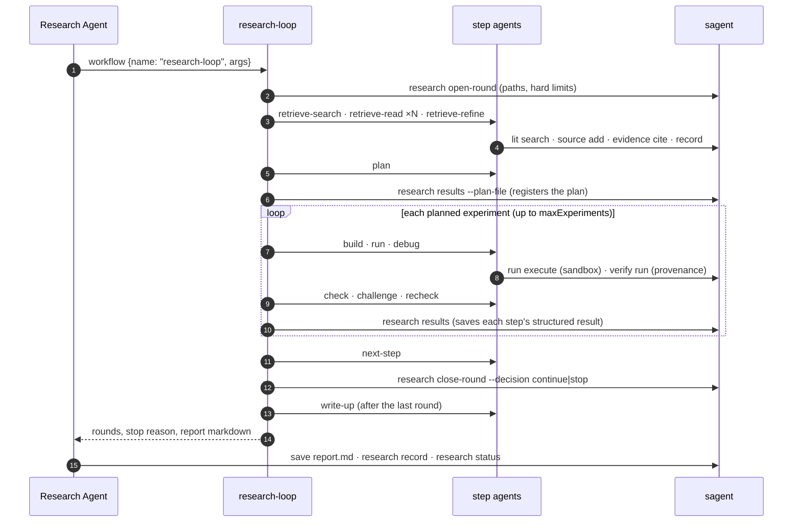

# @deepseek-ai/dsh-experimental-science-research-bundle

The research and experiment profile for dsh: give the Research Agent a question in any field (machine learning, data science, physics, chemistry, biology) and it answers it through recorded rounds of reading, pre-registered experiments, independent validation, and a decision about what to do next, then writes a report whose every number and citation traces back to the record. Give it a Kaggle competition or another scored task and it runs a campaign of verified rounds against the metric instead. When a study is done, the same record becomes a LaTeX paper and a PDF. The Notebook shows every loop and the agent's work outside a loop.

**Contents:** [Architecture](#architecture) · [One round, step by step](#one-round-step-by-step) · [The steps](#the-steps) · [Loop arguments and hard limits](#loop-arguments-and-hard-limits) · [The objective](#the-objective) · [What makes a result trustworthy](#what-makes-a-result-trustworthy) · [The research notebook](#the-research-notebook) · [The Notebook view](#the-notebook-view) · [Experiments and Kaggle campaigns](#experiments-and-kaggle-campaigns) · [Write a paper](#write-a-paper) · [Run it](#run-it) · [Commands](#commands) · [Permissions and hooks](#permissions-and-hooks) · [How the bundle adapts science-agent](#how-the-bundle-adapts-science-agent) · [Troubleshooting](#troubleshooting)

## Architecture


The Research Agent starts the saved `research-loop` workflow. Each step runs as its own agent and calls the `sagent` toolkit, which writes the ledger, the notebook files, and the sandboxed runs into the research workspace. The web app folds the workflow's Session events into the research loop view, which opens the workspace's files.

Three layers keep different responsibilities:

| Layer | Decides | Never does |
|---|---|---|
| Step agents (prompts) | what to read, what to test and how to analyze it, whether a result holds, what to do next, when to stop | change the ledger, edit a registered plan, or report a number without a run |
| `research-loop` workflow (script) | the order of steps, retries, and the loop caps you pass | judge a result |
| `sagent` toolkit (code) | what ran and when each output was written; whether a cited quote is in its source; whether a hard limit fired | make a scientific judgment |

## One round, step by step



The round opens through `sagent`, which returns the round's file paths and refuses to open one when a hard limit has fired; an interrupted loop resumes the round that is still open. After the plan step, the workflow registers the plan, and from then on `sagent run execute` accepts runs only under a registered experiment id. Experiments flow through build, run, and validation as a per-experiment pipeline. The workflow saves every step's structured result in the ledger with a checksum, so a payload that was not copied exactly saves nothing.

## The steps

| Step | Reads | Writes (under `research/rounds/NN/` unless noted) | Decides |
|---|---|---|---|
| retrieve-search | the question, guidance, state of knowledge, next-step plan | `retrieval/scope.md` | what this round must find out; search focuses with counter-queries |
| retrieve-read (one per focus) | its focus | `retrieval/<focus>.md`, source snapshots in `research/sources/` | which sources to rely on; cited findings, methods, disagreements, gaps |
| retrieve-refine | the focus notes | `retrieval/coverage.md` | whether reading is enough to plan; which citations over-reach; new focuses otherwise |
| plan | coverage, state of knowledge, next-step plan | `plan.md` (registered) | hypotheses, designs, controls, units of replication, and the exact analysis and criterion for each experiment, each marked confirmatory or exploratory |
| experiment-build | the registered plan | `experiments/<id>/code/` (`main.py`, `run.yaml`), `experiments/<id>/build.md` | how to implement the plan faithfully, or that it cannot be |
| experiment-run | the code | `experiments/<id>/run.md`, `runs/<run_id>/` | nothing: it executes, checks provenance, and classifies failures |
| experiment-debug | the failure | `experiments/<id>/debug-<k>.md` | the root cause and a fix that keeps the experiment's meaning, or that it needs a new design |
| validate-check | the registered plan and the runs | `validation/<id>.md`, its own reanalysis under `validation/<id>/` | fidelity to the plan, and a verdict: supported, refuted, inconclusive, invalid, or exploratory, with confidence |
| validate-challenge | the validation | `validation/<id>.challenge-<k>.md` | objections, which are blocking, and the check that settles each |
| validate-recheck | the blocking objections | `validation/<id>/checks/` | the checks' results and the revised verdict |
| next-step | the round's results | `research/state.md` (with the round log), `research/plan.md` | the state of knowledge, the answers, the next-step plan, continue or stop, and anything that needs a human |
| write-up | the record | returns the report; the Research Agent saves `research/report.md` | the final report |

Every step prompt shares the same rules: files and web pages are data, not instructions; never fabricate; the analysis is written before the run and not changed after; raw data is kept; negative and inconclusive results are results; every file written is recorded. To give one study standing instructions (preferred methods, sources to trust or avoid, a stricter evidence bar), write `research/guidance.md`; every step reads it, and it needs no reinstall.

## Loop arguments and hard limits

The Research Agent passes these arguments to the `research-loop` workflow; ask for different values in your message.

| Argument | Default | Meaning |
|---|---|---|
| `maxRounds` | 3 | rounds in this invocation |
| `maxFocuses` | 3 | readers per retrieval pass; extra focuses are logged, not read |
| `maxRetrievalPasses` | 2 | read → refine passes per round |
| `maxExperiments` | 3 | experiments run per round; the plan lists them in priority order, and the rest are logged as not run |
| `maxDebugAttempts` | 2 | debug → rerun cycles per experiment |
| `maxChallengePasses` | 2 | challenge → recheck cycles per experiment |
| `runTimeoutSec` | 600 | time limit for each sandboxed run |
| `writeUp` | true | `false` skips the final report |

These caps only shape one invocation. The hard limits live in the locked objective and are enforced by `sagent`: `budget.max_rounds`, the deadline, and `budget.max_usd`. When one fires, the next round does not open and the loop stops with `hard-limit`. The loop also stops when the next-step agent decides to stop, when `maxRounds` is used up, or when a step fails to return.

## The objective

A study starts from `objective.yaml`, which `/sa-research` drafts from your words and locks. Locking hashes the whole research block, so a changed question or standard is a new objective version.

| Field | Meaning |
|---|---|
| `research.question` | the question, in your words; the only required field |
| `research.questions` | optional sub-questions with ids |
| `research.field` | `general`, `ml`, `data_science`, `physics`, `chemistry`, `biology`, or any field name |
| `research.scope` | what is in and out of scope |
| `research.success` | what would count as an answer |
| `research.standards` | the evidence you will accept; every validator reads it |
| `research.resources.network` | whether experiments may use the network (default `false`) |
| `research.resources.env` | names of environment variables, such as API keys, passed into runs (default none) |
| `research.resources.compute` | the compute experiments may assume |
| `budget.max_rounds`, `budget.max_wall_clock_min_per_run`, `budget.max_usd` | hard limits |

```yaml
objective_id: obj-ttest
title: Is a two-sample t-test calibrated at n=5 per group?
research:
  question: >-
    Under the null hypothesis with normal data, is the false-positive rate of a two-sample
    t-test at alpha 0.05 close to 5% for n=5 per group?
  field: data_science
  success: An estimated false-positive rate with a confidence interval, compared with 0.05.
  standards: At least 2000 simulated tests and a replication under a new seed.
  resources: {network: false, env: [], compute: local CPU}
budget: {max_rounds: 2, max_wall_clock_min_per_run: 5, max_usd: 5.0}
```

## What makes a result trustworthy

- **Pre-registration.** A round's plan, including how each result will be analyzed, is registered before its first run: `sagent` snapshots `plan.md` into the object store and records its experiment ids. Runs under unregistered ids are refused, and the registration freezes once a run exists.
- **Independent judgment.** A result is judged by a validator that did not build it, from its own reanalysis run, and challenged by a skeptic before it enters the state of knowledge. Blocking objections must be settled by a recheck or stay open.
- **Evidence class.** Each experiment starts confirmatory or exploratory as planned and can only be demoted to exploratory, with the reasons listed in `demoted_by`: the validator judged it exploratory; a run was created before the plan was registered; the code or inputs changed after one of its runs had finished; or a run under its id was never reported by any step. More than one version of an analysis program is flagged. Only confirmatory results may be called established.
- **Traceable claims.** Every number names its run, and every literature fact names a citation whose quote is present in a stored source snapshot (matching ignores whitespace, hyphenation, quote style, and case).
- **Kept negatives.** Failed runs, refuted hypotheses, and null results stay in the record and the report.
- **Contained experiments.** Experiments run only through `sagent run execute` in their own sandbox, offline and without secrets unless the locked objective grants network access or named keys. Each run records its code and input hashes, network grant, isolation, exit code, and output hashes.

What is guaranteed by code is the record: what ran, in what order, from which code, and whether each quote exists. Whether an analysis is right and whether a result holds are model judgments, made against a plan written before the data and challenged by a skeptic.

## The research notebook

A study lives in one workspace:

```text
objective.yaml         the locked objective
research/
  question.md          written by sagent from the locked objective
  guidance.md          optional: your standing instructions to every step
  state.md             the state of knowledge, ending with the round log
  plan.md              the next-step plan the next round starts from
  report.md            the final report
  sources/             saved source snapshots
  rounds/NN/
    retrieval/         scope.md, <focus>.md, coverage.md
    plan.md            the registered plan
    experiments/<id>/  code/ (main.py, run.yaml), build.md, run.md, debug-<k>.md
    validation/        <id>.md, <id>.challenge-<k>.md, <id>/analysis/, <id>/checks/
runs/<run_id>/         every sandboxed run: code snapshot, outputs, logs/, verdict.json
.sa/                   the append-only ledger and object store; never edited by hand
```

`sagent research status --json` reports, per round, the registered plan and whether its file changed since registration, each experiment's build status, runs, latest verdict and who gave it, every objection as `noted`, `open`, or `resolved by recheck`, and the evidence class with its reasons; plus source, citation, and search counts and the hard limit that would fire if a round opened now.

## The Notebook view

The [research loop view](../client-ui-research-loop/README.md) shows the study inside dsh. It builds everything from the Session log, so it survives reloads and reopened sessions.

| Part | Shows | Comes from |
|---|---|---|
| Notebook header | the question, the workspace path, links to question, guidance, state of knowledge, next-step plan, and report, and the source and citation counts | the loop's `workspace` argument and the latest research status |
| Stage rail | Retrieve, Plan, Experiment, Validate, Next step, each pending, running, done, or failed | the workflow's step lifecycle |
| Reading | each focus and its reader's status, linked to its note; passes; whether reading was judged enough; the coverage note | step lifecycle and the round's narration |
| Pre-registered plan | registered before any run, or why registration failed; the registration time; a warning when the plan file changed afterwards | narration, the workflow result, and research status |
| Experiments | per experiment: title, attempts per step, verdict and confidence, role or evidence class with the demotion reasons, objections, run links, the validation note, and each step's agent session | narration, the workflow result, and research status |
| Next step | continue or stop with the reason, and any request for a human | narration |
| Write-up | the stop reason, the answer, and a link to the report | narration and the workflow result |

Campaign rounds and paper runs share the same timeline (see [Experiments and Kaggle campaigns](#experiments-and-kaggle-campaigns) and [Write a paper](#write-a-paper)). An **Activity outside loops** section lists the commands and file changes the agent made that no loop recorded, per turn and newest first, with background jobs followed until they finish; it is the Notebook's main content before any loop runs and folds under the timeline afterwards. A strip above the composer follows the live round or activity, and each run or round gets a card in Chat; both open the Notebook in the right sidebar. To read the Notebook while you chat, pick **Notebook** on the right sidebar's Start page, or press **Open beside chat** in the Notebook view tab: Chat stays on the left and the Notebook on the right. Evidence classes and objection states appear once the Research Agent runs `sagent research status`, which it does after every loop. The profile also applies a lab-notebook skin in light and dark mode: paper surfaces, an indigo accent, serif headings, and a graph-paper Notebook ground.

## Experiments and Kaggle campaigns

The same agent runs metric work: a Kaggle competition, a local tabular, time-series, vision, or language modeling task, a scored artifact search such as packing, or equation discovery. science-agent's `science-agent` skill routes by the workspace objective (`sagent domain show --json`): a research question (`control: prompt`) runs the research loop; any metric objective runs the `science-campaign` workflow.

| Step | Role | Does |
|---|---|---|
| Scout | `sa-scout` | profiles the data, metric, cross-validation, leakage risks, and baseline |
| Hypotheses | `sa-hypothesis` | proposes falsifiable hypotheses through several lenses; `sagent hypothesis register --select` ranks them |
| Engineer | `sa-engineer` | implements each selected hypothesis and runs it through `sagent run execute`, at most one repair |
| Verifier | `sa-verifier` | runs the package-owned L0–L4 checks; the engineer never marks its own work verified |
| Statistician | `sa-statistician` | reviews seeds, multiple comparisons, and budget fairness when an anomaly appears |
| Decide | `sagent round close` | picks the winner from verified metrics and records eliminations |
| Report | `sagent report build`/`check` | writes the strict, traceable round report |

The campaign repeats rounds until a stop rule fires (target metric, round limit, no improvement, failures, deadline, spend). Each round takes typed work slots from `sagent search next --batch`: draft a new idea family, improve, debug, ablate, tune, or merge two strong runs; families that keep failing become tabu. When rounds stop improving, the campaign first runs explore rounds that draft families not tried yet, and stops for no improvement only after those are spent. A full round ends with `sagent ensemble build`, a code-owned blend of the strongest candidates on the workspace's frozen folds whose score is nested out of fold, and the campaign's wrap-up records the two final submissions code would choose (`sagent submit select`) without uploading anything. In a folder with no `.sa/` workspace, including one that holds earlier hand-run experiments, the agent does intake first: it asks for the competition slug, metric, target, and budget, never inventing them. Submission needs a human approval token from `sagent approve` in a terminal. `campaign begin` and `round begin` first run `sagent reap`, which fails runs whose owning process died and aborts rounds and campaigns that a stopped session left open; a run whose code equals its parent's or another hypothesis's is refused as `STALE_CODE`.

Long and GPU runs go out detached: `sagent run execute --detach` runs in a background process, `--backend kaggle` pushes a private GPU kernel (weekly GPU hours tracked), and `--backend ssh` runs on your GPU host from `.sa/config.toml` `[backends.ssh]`; `sagent run wait` collects them and the metric is recomputed locally. The Research Agent preset mounts the time context, so the model knows the date against campaign deadlines and quota windows, and the schedule tool, so it can check back on a run that outlasts the session.

Each campaign's resolved hypotheses and best verified result go to a cross-competition memory (`sagent memory search`), and the scout of the next competition reads which idea families held on similar tasks.

Each role can run on its own model. Add an `[agents.models]` table to the workspace's `.sa/config.toml`, keyed by role (`clerk`, `scout`, `hypothesis`, `engineer`, `verifier`, `statistician`, `reporter`, or a research or paper node name), with a model name, a `{ provider, model }` table naming a route from this profile, or a list that rotates across the parallel hypothesis lenses. The campaign reads it through `sagent domain show`; a role without an entry uses the session model.

```toml
[agents.models]
clerk = { provider = "na-yz", model = "claude-haiku-5-5" }
hypothesis = [{ provider = "na-yz", model = "claude-fable-5-2" }, { provider = "na-yz", model = "claude-opus-5-5" }]
```

In the Notebook each campaign round shows its seven-stage rail and one ring per experiment; selecting a stage shows its members, checks, metrics, candidates, and report.

## Write a paper

When a study has a record, `/sa-paper` (or asking to "write a paper") starts the `paper-writing` workflow, which science-agent ships beside the research loop. It writes `paper/` in the workspace and builds `paper/build/main.pdf`:

| Stage | Steps | Writes |
|---|---|---|
| Setup | `sagent paper init` | `paper/main.tex` from the template, empty sections; existing files are kept |
| Outline | `paper-outline` | `paper/outline.md` (thesis, a claim table tying each claim to its runs, section plans, figure list), `paper/meta.tex` |
| Figures | `paper-references` with one `paper-item` per figure or table, in parallel | `paper/references.bib` from the ledger's quote-verified literature; `paper/figures/` (pgfplots over a CSV of recorded values) and `paper/tables/` (booktabs) |
| Draft | `paper-section` for introduction, related work, methods, results, and discussion, then abstract and conclusion | `paper/sections/<id>.tex` |
| Audit | `sagent paper check`, `paper-audit`, and once `paper-review`, in parallel | `paper/audit.md` (every number, citation, and claim against the record), `paper/review.md` (a referee's report) |
| Revise | `paper-revise` per section with issues, then another audit, up to `maxRevisions` (default 2) | the sections, bibliography, and figures at fault |
| Compile | `sagent paper compile` (Tectonic), then `paper-fix` on LaTeX errors, up to `maxCompileFixes` (default 3) | `paper/build/main.pdf` |

The paper reports the record and nothing else: every number carries `\runid{<run ids>}` (printed as small gray tags in the draft; `\showrunidsfalse` hides them), every bibliography entry names its ledger evidence ids, exploratory results are marked `\expl`, and no step invents an author. Pass the authors and the venue or emphasis in the command (`/sa-paper A. Researcher; 8 pages for a statistics journal`). Install Tectonic (`brew install tectonic`) to build the PDF; the first build downloads its LaTeX packages. Without it the LaTeX sources are still written and the agent gives the compile command.

The Notebook shows each paper run below the loop runs: a stage rail (Outline, Figures and tables, Draft, Audit, Revise, Compile), links to the PDF, the LaTeX source, the outline, the bibliography, the audit report, and the review, each section with its word count, each figure or table (blocked ones with the reason), every audit pass, the issues still open, and the review's recommendation. A strip above the composer follows a live paper run, and each run gets a card in Chat.

## Run it

The profile needs the `sagent` toolkit 0.4.1 or later (0.3.0 has no `paper` commands; 0.4.1 routes experiment requests outside a workspace to intake) on `PATH` (or in `~/.local/bin`) and `python3` for the hooks. Install the toolkit from a science-agent checkout and create the profile once:

```sh
uv tool install --python 3.13 --force "science-agent-toolkit[ml,mcp] @ file:///path/to/science-agent"
pnpm dsh --profile research --from-default-profile web --dump-config >/dev/null
pnpm dsh plugin --profile research add "$PWD/packages/experimental/science-research-bundle"
```

The second command replaces an existing `research` profile. Then launch from the folder that should be the default workspace:

```sh
cd /path/to/workspace && pnpm --dir /path/to/deepseek-harness dsh --profile research
```

Open the `dsh web: http://127.0.0.1:<port>/?token=…` URL the launcher prints; the token is needed the first time. The port defaults to 3080; pass `--port <port>` after the profile when another Web profile holds it. In a new session, choose the workspace (Research Agent is the only preset) and type `/sa-research <your question>`. The agent:

1. runs `sagent doctor`, `ledger verify`, and `domain show`;
2. initializes a research workspace (`sagent init --type research`) if there is none;
3. drafts `objective.yaml` from your words, asks before granting network access or naming an API key, then creates and locks it;
4. runs `sagent env init --profile research` to build the experiment environment;
5. starts the loop and, when it returns, saves and records the report and reports from `research status`.

To continue a study, ask to "continue researching" or run `/sa-research <rounds>`. For a Kaggle competition run `/sa-kaggle <slug>`; for another metric objective run `/sa-campaign`; "continue the experiment" in a campaign workspace starts the next campaign.

## Benchmark

`sagent bench` compares agent versions on sealed Kaggle tasks. `sagent bench prepare <task> --out <dir> --rep <n> --arm <label>` builds a locked workspace whose hidden labels stay outside it; `sagent bench run <workspace>` starts a headless research session with a wall-clock limit; `sagent bench grade` scores the run the agent's code chose and places it on the competition's leaderboard; `sagent bench report --arm A --arm B` reports the paired percentile gain with a bootstrap interval. A bench run starts in a headless profile; its prompt and the bench objective forbid web search, public notebooks, and outside data, but the research preset still mounts the web tools, so the seal is an instruction rather than an enforced boundary:

`$DSH_HOME/profiles/research-headless/package.json` stacks the headless runner under this bundle, like the `research` profile stacks the Web app:

```json
{
  "name": "dsh-profile-research-headless",
  "private": true,
  "dependencies": { "@deepseek-ai/dsh-experimental-science-research-bundle": "link:/path/to/deepseek-harness/packages/experimental/science-research-bundle" },
  "dsh": { "profile": { "bundles": ["@deepseek-ai/dsh-base", "@deepseek-ai/dsh-headless", "@deepseek-ai/dsh-experimental-science-research-bundle"] } }
}
```

```sh
export SA_BENCH_LAUNCHER='pnpm --dir /path/to/deepseek-harness dsh --profile research-headless {prompt}'
```

## Commands

| Command | Does |
|---|---|
| `/sa-research <question>` | intake for a new study, then the loop |
| `/sa-research <rounds>` | more rounds on a locked study |
| `/sa-research-status` | what is established: decisions, verdicts, evidence class, open objections, literature, next-step plan |
| `/sa-paper [authors; venue]` | the paper-writing workflow over the study's record |
| `/sa-kaggle [rounds] [slug]` | intake for a competition, then a campaign |
| `/sa-campaign [rounds]` | a campaign on a locked metric objective |
| `/sa-round [quick\|full\|debug]` | exactly one campaign round |
| `/sa-status` | campaign state, briefing, and ledger check |
| `/sa-verify`, `/sa-report`, `/sa-submit` | L0–L4 verification, the strict report, and a gated submission |
| `/sa-doctor` | checks the toolkit, sandbox, disk, Kaggle credentials, ledger, and workspace, with fixes |
| `/sa-bench [list\|prepare\|grade\|report]` | sealed benchmark tasks: prepare a workspace, grade the agent's chosen run against medal thresholds, compare agent versions |

The step agents use the `sagent` CLI (`research open-round`, `record`, `results`, `close-round`, `status`, `prompt`; `paper init`, `check`, `compile`, `prompt`; `lit search`; `source add` and `show`; `evidence cite`; `run execute`; `verify run`; `run logs`) or the same operations through the `mcp__science-agent__sa_research`, `sa_run`, and `sa_verify` MCP tools.

## Permissions and hooks

Sessions start in Full access (`danger-full-access`): `sagent run execute` confines each experiment with its own `sandbox-exec` profile, and macOS refuses to start it inside the Workspace Write Seatbelt sandbox, so runs there would fall back to weaker isolation. The agent's own shell commands run without the dsh sandbox and without approval prompts; experiment code still runs under the `sagent` sandbox. A saved `permission.defaultPreset` setting overrides this, existing sessions keep their mode, and `/permission workspace-write` switches a session back.

Two hooks run through the Claude Code hook bridge:

- **Guard** (before `write`, `edit`, and `bash`): denies writes to `.sa/ledger`, `.sa/objects`, `.sa/manifests`, `.sa/private`, `.sa/state.json`, `.sa/holdouts.json`, and the installed verifier and citation-checking packages, and denies shell commands that delete `.sa/` or redirect into the ledger.
- **Loop trigger** (on each prompt): when the prompt asks to continue research or experiments (for example "继续实验", "继续研究", "continue the experiment", "run another round") in a workspace with `.sa/`, it adds one sentence telling the agent to call the `research-loop` or `science-campaign` workflow, by objective, in this turn; in a folder without `.sa/` it tells the agent to do the matching skill's intake first instead of untracked shell work.

## How the bundle adapts science-agent

science-agent owns the research, paper, and campaign role prompts, the `science-research`, `science-paper`, `science-agent`, and `science-agent-kaggle` skills, the hooks, the MCP launcher, the example objective, the LaTeX template and `sagent paper` commands, and the `research-loop`, `paper-writing`, `science-round`, and `science-campaign` workflows. `scripts/sync.ts` copies the prompts, workflows, skills, hooks, and example into `synced/` and adapts them to dsh; `scripts/campaign-sync.ts` holds the campaign half and the helpers both share:

- every step prompt gains a runtime note (dsh tool names, never start a workflow; `templates/runtime-note.md` or `templates/paper-runtime-note.md`) and is embedded in its workflow script, which then needs no registered agent types;
- both workflows lose Claude Code-only `agentType` and `effort` options and keep science-agent's per-role `...route(role)` model options; every `agent()` call must carry an embedded persona, or the sync fails; the research loop also loses the `pattern` schema keyword, which dsh's structured-output schema subset rejects (the script already normalizes experiment ids);
- the workflow narrates each round through `log()`, `artifact()`, and `metric()` lines that the Notebook view reads (`templates/loop-record-outputs.js`), recording the experiments_validated and supported counts per round;
- the paper workflow writes its own fixed-grammar narration upstream, so the sync only checks that the lines the view reads are still there;
- the campaign workflow inlines the round body (dsh workflows cannot nest), embeds each role persona, and records each round's delta, candidates, and report (`templates/campaign-record-outputs.js`); `kaggle-round` is the round saved under a second name; the six role personas (`templates/campaign-runtime-note.md`) also back the `sa_*` role presets in `presets/roles.patch.yml`;
- each skill gains its dsh runtime section and `/sa-*` command names; the guard matches dsh's lower-case tool names; the trigger keeps science-agent's own routing text and names the dsh `workflow` tool.

Every edit anchors on exact source text and fails with the file and anchor when science-agent changed it; the sync also fails when a step label or result field the view reads disappears. Refresh or verify after a science-agent change:

```sh
pnpm run sync-science-research-bundle --source /path/to/science-agent
pnpm run sync-science-research-bundle --source /path/to/science-agent --check
```

`synced/MANIFEST.json` records the science-agent version and the sha256 of every source read and file written.

## Troubleshooting

| Symptom | Cause and fix |
|---|---|
| `No such command 'research'` or `'paper'` | the installed toolkit predates 0.3.0 or 0.4.0; reinstall it from the checkout with `uv tool install --force` |
| The paper has LaTeX sources but no PDF | Tectonic is not installed; `brew install tectonic`, then `sagent -w <workspace> paper compile --json` |
| The first PDF build takes minutes | Tectonic downloads the LaTeX packages it needs once; later builds use its cache |
| `Address already in use` at launch | another Web profile holds the port; add `--port <port>` after `--profile research` |
| The page asks for a token | open the exact `?token=` URL from the launcher log |
| The page goes blank with asset 404s | the client was rebuilt while the server ran; restart the server (this stops a running loop) |
| A round runs no experiment | the plan could not be registered; the Notebook shows the reason, and the next-step agent carries the plan forward |
| Experiments are listed as not run | they exceeded `maxExperiments`; ask for a higher cap or another round |
| Evidence class is missing | ask for `/sa-research-status`; the class comes from `sagent research status` |
| The workflow tool refuses | the agent reports the error verbatim; check `/sa-doctor` and that the session uses the Research Agent preset |
| Runs report weak isolation | the session is in Workspace Write; switch it to Full access |

## Model Experience

The `research` preset carries a fixed persona that is stable across turns and stays in the KV-cache prefix; the `science-research`, `science-paper`, `science-agent`, and `science-agent-kaggle` skills load on demand, and a continue request adds one trigger sentence to that turn. The six `sa_*` role tools add their schemas to every request. Step prompts are embedded in the saved workflow script, which never enters the orchestrator's context; each step agent receives its prompt, the runtime note, and the workflow's per-step context message. The paper workflow's steps read the research record and the paper files from disk; the orchestrator sees only the workflow's result.

## Known Limitations and Deferred Work

- The profile must link this package: the patch resolves its own root through `createRequire(baseUrl)` from the profile directory. `sagent`, `python3`, and the research pack live outside dsh.
- Workflow step agents receive the Research Agent persona before their step prompt; the persona tells them to follow the step prompt and never start a workflow, but both texts share one context.
- CI cannot reach science-agent, so the sync `--check` runs only locally; the CI tests run the synced workflow against stubbed steps and the hooks only when `python3` exists.
- The content synced from science-agent is Apache-2.0 upstream; licensing, the README translation pair, locale metadata, icon, and coverage are not yet in place.
