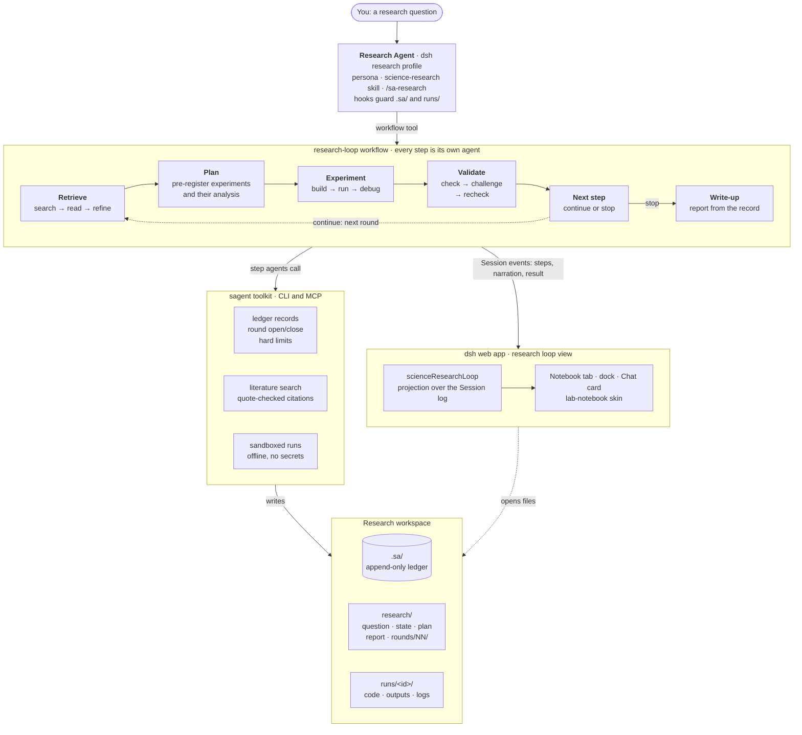

# @deepseek-ai/dsh-experimental-science-research-bundle

The research science loop for dsh: give the Research Agent a question in any field (machine learning, data science, physics, chemistry, biology) and it answers it through recorded rounds of reading, pre-registered experiments, independent validation, and a decision about what to do next, then writes a report whose every number and citation traces back to the record.

## Architecture



The Research Agent starts the saved `research-loop` workflow. Each step runs as its own agent and calls the `sagent` toolkit, which writes the ledger, the notebook files, and the sandboxed runs into the research workspace. The web app folds the workflow's Session events into the research loop view, which opens the workspace's files.

## The loop

```text
round:  Retrieve    retrieve-search → [retrieve-read per focus → retrieve-refine]*     until reading is enough
        Plan        plan: experiments and the analysis that will judge each, registered before anything runs
        Experiment  per experiment: experiment-build → [experiment-run → experiment-debug]*
        Validate    per experiment: validate-check → [validate-challenge → validate-recheck]*
        Next step   next-step: state of knowledge, next-step plan, continue or stop
end:    Write-up    the report, from the record only
```

Each step is a separate agent following its own prompt, so the research method is text: what to read, what to test and how to analyze it, whether a result holds, what to do next, and when to stop are all judged by the step prompts. The `research-loop` workflow only sequences the steps and enforces the loop caps. The `sagent` toolkit decides nothing scientific; it runs experiments in a sandbox, records when each step's output was written, checks that cited quotes exist in their stored sources, and enforces the hard limits on rounds, deadline, and spend.

| Step | Decides |
|---|---|
| retrieve-search | what this round must find out; search focuses with counter-queries |
| retrieve-read | which sources to rely on; cited findings, methods, disagreements, gaps |
| retrieve-refine | whether reading is enough to plan; which citations over-reach |
| plan | hypotheses, designs, controls, units of replication, and the exact analysis and criterion for each |
| experiment-build | how to implement the plan faithfully, or that it cannot be |
| experiment-run | nothing: it executes, checks provenance, and classifies failures |
| experiment-debug | the root cause and a fix that keeps the experiment's meaning, or that it needs a new design |
| validate-check | fidelity to the registered plan, and a verdict from its own reanalysis run |
| validate-challenge | objections, which are blocking, and the check that settles each |
| validate-recheck | the checks' results and the revised verdict |
| next-step | the state of knowledge, answers, the next-step plan, continue or stop |
| write-up | the final report |

## What makes a result trustworthy

- **Pre-registration.** A round's plan, including how each result will be analyzed, is registered before its first run; `sagent` refuses runs under unregistered experiment ids, and the registration freezes once a run exists.
- **Independent judgment.** A result is judged by a validator that did not build it and challenged by a skeptic before it enters the state of knowledge.
- **Evidence class.** Each experiment starts confirmatory or exploratory as planned and can only be demoted, with the reasons listed: a run before registration, code or inputs changed after a run finished, or a run no step reported. Only confirmatory results may be called established.
- **Traceable claims.** Every number names its run, and every literature fact names a citation whose quote is present in a stored source snapshot.
- **Kept negatives.** Failed runs, refuted hypotheses, and null results stay in the record and the report.
- **Contained experiments.** Experiments run only through `sagent run execute` in their own sandbox, offline and without secrets unless the locked objective grants network access or named keys; the agent asks before granting either.

## The research notebook

A study lives in one workspace:

```text
objective.yaml       the question, field, scope, success criterion, evidence standards, budget (locked)
research/
  question.md        written from the locked objective
  guidance.md        optional: your standing instructions to every step
  state.md           the state of knowledge, ending with the round log
  plan.md            the next-step plan the next round starts from
  report.md          the final report
  rounds/NN/         retrieval notes, the registered plan, experiment code, validation notes
runs/<run_id>/       every sandboxed run: code snapshot, outputs, logs, verdict
.sa/                 the append-only ledger and object store (never edited by hand)
```

In the app, the **Notebook** tab beside Chat shows the study as it runs: links to these files, then each round's stage rail, reading focuses with source and citation counts, whether the plan was registered before any run, an experiments table with verdict, confidence, evidence class and the reasons for any demotion, objections, and run links, and the next-step decision. A strip above the composer follows the live round, and each run gets a card in Chat. These surfaces come from the [research loop view](../client-ui-research-loop/README.md).

## Run it

The profile needs the `sagent` toolkit 0.3.0 or later and `python3`:

```sh
uv tool install --python 3.13 --force "science-agent-toolkit[ml,mcp] @ file:///path/to/science-agent"
pnpm dsh --profile research --from-default-profile web --dump-config >/dev/null
pnpm dsh plugin --profile research add "$PWD/packages/experimental/science-research-bundle"
cd /path/to/workspace && pnpm --dir /path/to/deepseek-harness dsh --profile research
```

Open the `?token=` URL the launcher prints, start a session (Research Agent is the only preset), and type `/sa-research <your question>`. The agent drafts and locks the objective, initializes the experiment environment, and runs the loop; `/sa-research <rounds>` or "continue researching" runs more rounds, `/sa-research-status` reports what is established, and `/sa-doctor` checks the toolkit. Sessions start in Full access because `sagent` confines each experiment with its own `sandbox-exec` profile, which macOS refuses to nest inside the Workspace Write sandbox.

The loop content is synced from a science-agent checkout; refresh it after science-agent changes with `pnpm run sync-science-research-bundle --source /path/to/science-agent` (add `--check` to verify).

## Model Experience

The `research` preset carries a fixed persona that is stable across turns and stays in the KV-cache prefix; the `science-research` skill loads on demand, and a continue-research request in a workspace with `.sa/` adds one trigger sentence to that turn. Step prompts are embedded in the saved workflow script, which never enters the orchestrator's context.

## Known Limitations and Deferred Work

- The profile must link this package, and `sagent`, `python3`, and the research pack live outside dsh.
- Workflow step agents receive the Research Agent persona before their step prompt.
- The content synced from science-agent is Apache-2.0 upstream; licensing, the README translation pair, locale metadata, icon, and coverage are not yet in place.
